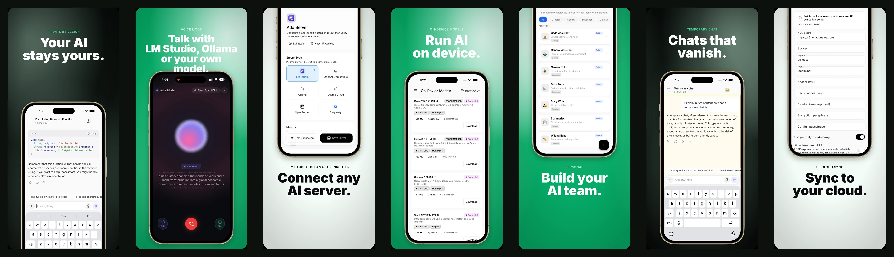
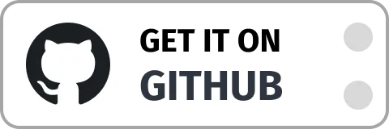

# LocalMind

**Your AI. Your Device. Your Rules.**

LocalMind is an open-source Android and iOS chat app for LLMs. Run GGUF and LiteRT models fully offline on your phone, or connect to Ollama, LM Studio, OpenRouter, and any OpenAI-compatible server, with MCP tool support built in.

<p align="center">
  <a href="https://github.com/abdulmominsakib/localmind/releases/latest"></a>
  <a href="LICENSE"></a>
  <a href="https://github.com/abdulmominsakib/localmind/stargazers"></a>
  
  
</p>



<p align="center">
  <a href="https://apps.apple.com/us/app/localmind-ollama-lm-studio/id6777025480">
    
  </a>
  <a href="https://play.google.com/store/apps/details?id=pro.momin.localmind">
    
  </a>
  <a href="https://github.com/abdulmominsakib/localmind/releases">
    
  </a>
</p>

## Vision

Built for those who value privacy and performance, LocalMind runs models directly on your device or connects straight to your own inference servers like **LM Studio** or **Ollama**, as well as cloud providers like **OpenRouter** or **Requesty**. No middleware, no tracking, and no hidden subscriptions. Just you and your models.

## Supported Backends

| Backend | Type | Notes |
| --- | --- | --- |
| On-device | Offline | GGUF (llama.cpp via `llamadart`) and LiteRT (`flutter_gemma`) models |
| [Ollama](https://ollama.com/) | Local | Also supports Ollama Cloud |
| [LM Studio](https://lmstudio.ai/) | Local | Includes the LM Studio model catalog |
| [OpenRouter](https://openrouter.ai/) | Cloud | Bring your own API key |
| [Requesty](https://www.requesty.ai/) | Cloud | Bring your own API key |
| OpenAI-compatible | Local or cloud | llama.cpp server, vLLM, LocalAI, Jan, and others |

## Key Features

- **On-Device AI Support (iOS & Android)**: Private, fast, and offline. Run powerful GGUF and LiteRT models (Gemma, Qwen, DeepSeek R1) directly on your device via `llamadart` and `flutter_gemma`. No internet connection required.
- **Model Context Protocol (MCP)**: Seamlessly connect to local or remote MCP servers. Grant models access to custom tools and integrations (e.g., file access, web APIs, shell actions) with fine-grained global and chat-level toggles.
- **Model Manager**: Download curated models or download GGUF models directly from HuggingFace. Manage model files directly within the app.
- **Multi-Server Connection**: Connect to Ollama, LM Studio, OpenRouter, Requesty, or any OpenAI-compatible API with real-time server health and speed monitoring.
- **Premium Chat Experience**: A polished, Claude/ChatGPT-inspired user interface featuring:
  - **Streaming Responses**: Real-time SSE support for instant generation.
  - **Markdown Rendering**: Beautiful rendering of text and code with rich syntax highlighting.
  - **Expandable Reasoning Logs**: Collapsible, step-by-step visualization of thought processes for reasoning models like DeepSeek R1.
  - **Edit & Regenerate**: Edit past user prompts to truncate the conversation history and regenerate responses.
  - **Saved Messages Picker**: Quick-access shortcut in the input bar to store, organize, and reuse prompts or templates.
  - **Message Variants**: Swipe and navigate through alternative model replies/variations.
  - **Temporary Chats**: Incognito mode that allows conversations to run in-memory without saving logs to local history.
  - **Smart Suggested Replies**: Context-aware follow-up prompts to keep conversations going.
- **Voice & Audio (STT & TTS)**:
  - **Speech-to-Text (STT)**: Dictate your prompts directly via native voice input.
  - **Text-to-Speech (TTS)**: Listen to model responses with custom playback speeds, replay caching, and background play.
- **Multimodal & Attachments**: Attach photos, documents, and other files to prompt vision-capable models.
- **Persona Management**: Easily switch between specialized AI personas (Code Assistant, Math Tutor, etc.) or create your own with custom system instructions.
- **Live Model Swapping**: Swap active models mid-conversation without breaking context or losing chat history.
- **Conversation History**: Full-text search through your chats, folder grouping, pinning, and local-only storage.
- **Backup & Restore**: Export and import complete backup archives (including chat history, personas, and app settings) locally.
- **Multilingual UI**: Available in 15 languages, including English, Spanish, German, French, Japanese, Chinese, Arabic, Hindi, and Bengali.
- **Deep Customization**:
  - **Theming**: Premium dark-first interface with full light mode support.
  - **Chat Parameters**: Fine-tune temperature, top_p, max token limits, and context window size.

## Tech Stack

LocalMind is built with modern, scalable technologies:

- **Framework**: [Flutter](https://flutter.dev/) 3.44 (pinned with [FVM](https://fvm.app/))
- **On-Device AI**: `llamadart` + `flutter_gemma` (supporting llama.cpp & LiteRT) for native, high-performance localized inference.
- **UI Components**: Shadcn-inspired design system (`shadcn_ui`)
- **State Management**: [Riverpod](https://riverpod.dev/) for robust, testable state.
- **Local Storage**: [ObjectBox](https://objectbox.io/) for high-performance on-device persistence.
- **Networking**: [Dio](https://pub.dev/packages/dio) for optimized REST API handling.
- **Rendering**: `gpt_markdown` + `syntax_highlight` for rich content.

## Privacy First

- **Zero Analytics**: We don't track how you use the app.
- **Local Storage**: Your conversations are stored only on your device.
- **Direct Traffic**: Network requests go directly to _your_ servers. LocalMind never sees your data.
- **Encrypted Sync (optional)**: Cloud sync is end-to-end encrypted and only talks to an S3 bucket you control.

## Contributors

We are incredibly grateful to the developers who have helped build LocalMind:

<p align="left">
  <a href="https://github.com/abdulmominsakib">
    
  </a>
  <a href="https://github.com/onlypuppy7">
    
  </a>
  <a href="https://github.com/leo-rnl">
    
  </a>
  <a href="https://github.com/dtrknt15">
    
  </a>
  <a href="https://github.com/NJannasch">
    
  </a>
  <a href="https://github.com/ystartgo">
    
  </a>
</p>

## Recently Shipped

Have an idea for what comes next? [Open a feature request](https://github.com/abdulmominsakib/localmind/issues/new/choose).

- [x] **AI Voice (Text-to-Speech)**: Listen to your AI's responses with high-quality TTS.
- [x] **Context Smart Replies**: Integrated suggested follow-ups to keep the conversation flowing.
- [x] **Multimodal Support**: Attach images and documents for vision-capable models.
- [x] **Tablet/Desktop Optimization**: A split-view layout for large-screen productivity.
- [x] **Export Options**: Export your chats to Markdown or PDF to share or archive.
- [x] **Quick Shortcuts**: OS-level widgets and shortcuts for launching new chats instantly.
- [x] **Voice-to-Voice Mode**: Engage in real-time, low-latency spoken conversations with local models.
- [x] **S3 Cloud Sync**: End-to-end encrypted cloud sync for settings, custom personas, and chats in your own S3 server.

## Getting Started

### Prerequisites

- [FVM](https://fvm.app/) (the project pins Flutter 3.44.2 in `.fvmrc`)
- Android Studio or Xcode with a device or emulator
- Optional: a local LLM server such as [Ollama](https://ollama.com/) or [LM Studio](https://lmstudio.ai/). On-device models work without one.

### Installation

```bash
git clone https://github.com/abdulmominsakib/localmind.git
cd localmind
fvm install
fvm flutter pub get
fvm flutter run
```

### Useful Commands

- `fvm flutter analyze` runs lints and analyzer checks.
- `fvm flutter test` runs the test suite.
- `fvm flutter gen-l10n` regenerates localization output after editing `lib/l10n/app_*.arb`.
- `fvm dart run build_runner build --delete-conflicting-outputs` regenerates ObjectBox code after entity changes.

### Connecting to a Server on Your Computer

When running Ollama or LM Studio on your computer, use its LAN IP (for example `http://192.168.1.20:11434`), not `localhost`, and make sure the server listens on all interfaces. For Ollama, set `OLLAMA_HOST=0.0.0.0`. In LM Studio, turn on "Serve on Local Network".

## Contributing

Contributions are welcome. Read [AGENTS.md](AGENTS.md) for the project structure, architecture rules, and commit conventions, then open an issue or pull request. Please run `fvm flutter analyze` and `fvm flutter test` before submitting.

---

## License

LocalMind is open source and available under the [MIT License](LICENSE).
